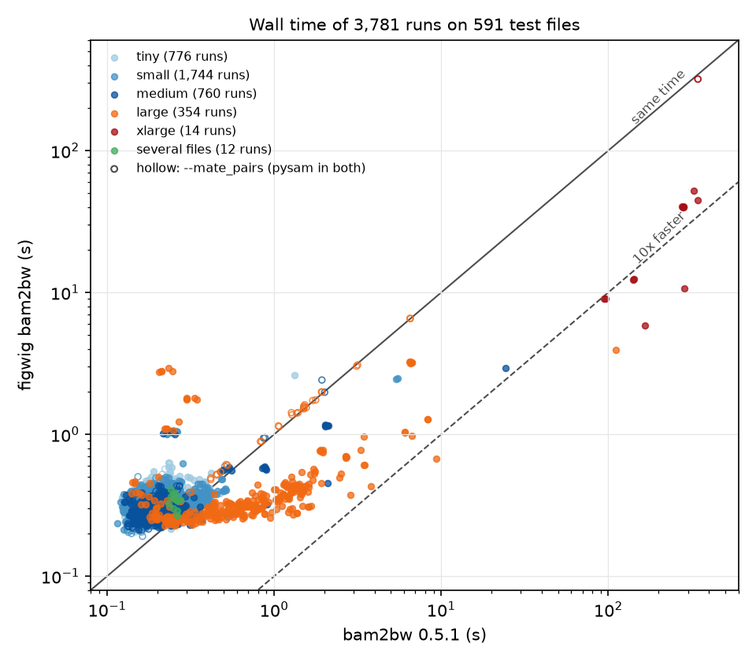
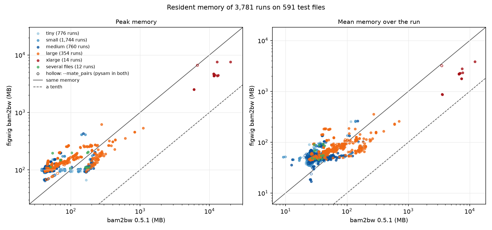
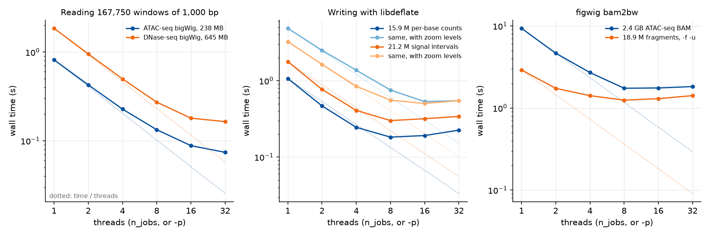

# figwig

[](https://pepy.tech/projects/figwig) [](https://github.com/jmschrei/figwig/actions/workflows/python-package.yml) [](https://figwig.readthedocs.io/en/latest/?badge=latest)

[[docs](https://figwig.readthedocs.io/en/latest/index.html)][[release notes](https://figwig.readthedocs.io/en/latest/whats_new.html)]

A fast, multithreaded reader and writer of bigWig and figwig files, into and out of
numpy. Also contains a formal specification of the figwig file format, which holds
any number of per-base tracks over one genome with a JSON record of attributes for
each, and reads windows from any subset of them in one call, into 
`(windows, tracks, width)`. `figwig bw2fw` `fw2bw`, and `bam2fw` convert bigWigs
and reads to and from a figwig file. 

Built on work from Nezar Abdennur and Jack Huey.

Loading training data for a genomics model means reading the signal under tens
or hundreds of thousands of windows: 1,000 bp around every peak and background
region of an experiment, say. figwig reads all of them in one call, straight
into a float32 array, from one bigWig or from several at once, and writes
bigWigs from the same windows, such as a model's predictions, or from
intervals. The common readers make one call per window, and each call holds
Python's GIL, so adding threads does not help them. figwig decompresses and
compresses with zlib or libdeflate and decodes with numba, all without the
GIL, so its threads run in parallel. It depends only on numpy and numba.

Its command, `figwig bam2bw`, turns SAM/BAM files of reads, or BED/tsv files
of fragments, into bigWigs of per-base counts. It is
[bam2bw](https://github.com/jmschrei/bam2bw) with the same arguments, outputs
and messages, with faster readers.

| | figwig | fastest other tool |
|---|---|---|
| Read 167,750 windows of 1,000 bp from an ATAC-seq bigWig | **0.135 s** on 8 threads | 1.25 s, pybigtools |
| Write 15.9 million per-base counts | **0.18 s** on 8 threads | 4.20 s, pyBigWig |
| Write 21.2 million intervals, with zoom levels | **0.55 s** on 8 threads | 5.47 s, pybigtools |
| Convert a 2.4 GB ATAC-seq BAM to two stranded bigWigs | **4.65 s**, 910 MB peak, at `-p 2` | 58.48 s, 3,039 MB peak, bam2bw 0.5.1 |
| The same BAM's per-base coverage, like deepTools | **1.6 s** at `-p 8` | 14.9 s on 8 processes, `bamCoverage --binSize 1`, the same value at every base |
| Read 8,192 windows of 2,048 bp from 48 count tracks on chr1 | **0.085 s** on 8 threads, **0.044 s** on 32, from one figwig file | 0.27 s and 0.11 s from 48 bigWigs, figwig; 5.9 s pybigtools; 4.0 s zarr |
| A DataLoader batch of 64 windows x 48 tracks as a CUDA tensor | **4 ms** from one figwig file | 30 ms from the bigWigs, figwig; 120 ms pybigtools |
| 10 pseudobulks of 10,246 cells over 8,192 windows | **0.30 s** on 8 threads | 5.1 s from an in-memory scipy CSR; 95 s from one bigWig per cell |
| Convert 257.6 million 10x fragments to 10,246 per-cell tracks | **9 s** at `-p 8`, **5.5 s** at `-p 32`, 18 GB peak | 140 s, 24 GB, a pandas recipe; 217 s, 8 GB, SnapATAC2 (fragments, not counts) |

Measured on a 2x AMD EPYC 9575F with Python 3.13 and numba 0.68. The
[benchmarks page](https://figwig.readthedocs.io/en/latest/benchmarks.html) has
the full setup.

<details>
<summary><b>More numbers and plots</b></summary>

#### Reading

167,750 windows of 1,000 bp centred on the fold-0 training peaks and negatives
of ENCODE ATAC-seq experiment ENCSR123WME, read from the ATAC-seq bigWig
ENCFF830RWF (238 MB) and the DNase-seq bigWig ENCFF989SAK (645 MB) on tmpfs,
sorted by position, file opening included; median of three runs. The other
libraries' 8-thread runs split the windows into 8 chunks on a thread pool.
Every library returned the same values, once pyBigWig's NaN for bases without
an interval was set to 0.

| library | ATAC, 1 thread | ATAC, 8 threads | DNase, 1 thread | DNase, 8 threads |
|---|---|---|---|---|
| pybigtools 0.2.5, `values()` per window | 1.25 s | 1.42 s | 1.98 s | 2.21 s |
| pyBigWig 0.3.26, `values()` per window | 3.95 s | 4.08 s | 4.50 s | 4.64 s |
| pybbi 0.4.2, `stackup` | 9.61 s | 9.48 s | 10.75 s | 10.63 s |
| figwig 0.1.0 | 0.81 s | **0.135 s** | 1.85 s | **0.277 s** |

#### Writing

The plus-strand 5' ends of ENCODE ATAC-seq BAM ENCFF877LRY, as counts at
15,875,960 single bases, and the fold-change signal ENCFF932UQM, as 21,212,477
intervals, written from memory onto tmpfs at compression level 6, opening and
closing included; median of three runs. pybigtools always writes zoom levels.

| writer | counts | counts, zoom levels | signal | signal, zoom levels |
|---|---|---|---|---|
| pyBigWig 0.3.26 | 4.20 s | 12.80 s | 7.41 s | 10.48 s |
| pybigtools 0.2.5 | | 4.45 s | | 5.47 s |
| figwig, zlib, 1 thread | 4.25 s | 12.09 s | 6.21 s | 8.10 s |
| figwig, zlib, 8 threads | 0.53 s | 1.63 s | 0.78 s | 1.09 s |
| figwig, libdeflate, 1 thread | 1.07 s | 4.85 s | 1.80 s | 3.27 s |
| figwig, libdeflate, 8 threads | **0.18 s** | **0.75 s** | **0.30 s** | **0.55 s** |

figwig's files were the size of pyBigWig's. For the counts, its peak memory
was above pyBigWig's without zoom levels, 554 MB against 354 MB on one thread,
and below it with them, 739 MB on 8 threads against 1,089 MB.

#### figwig bam2bw

ENCODE ATAC-seq BAM ENCFF877LRY (2.4 GB) at default flags, and 18.9 million
scATAC-seq fragments with `-f -u`, from the page cache; figwig's median of
five runs at `-p 2` and one at `-p 8`, and one run of bam2bw, which reads one
file in one process whatever `-p` is.

| | BAM | fragments | peak memory, BAM | peak memory, fragments |
|---|---|---|---|---|
| bam2bw 0.5.1, `-p 2` | 58.48 s | 28.45 s | 3,039 MB | 2,866 MB |
| figwig bam2bw, `-p 2` | **4.65 s** | **1.73 s** | 910 MB | 1,061 MB |
| figwig bam2bw, `-p 8` | **1.82 s** | **1.31 s** | 949 MB | 1,180 MB |

Both also ran on every one of 591 public BAM, SAM, BED and TSV test files that
bam2bw takes, from 3 records to a 10 GB ATAC-seq BAM, under 5 to 9 sets of
flags each, timed once, 16 at a time. In all 3,781 runs that bam2bw
completed, figwig bam2bw gave the same exit code, messages and decoded
entries. Where bam2bw took a second or more, figwig bam2bw was a median 3.2
times faster; where bam2bw took under half a second, figwig bam2bw took a
median 0.12 s longer, mostly importing numba.





The memory runs were made before figwig bam2bw dropped the keys it had
counted while still reading a BAM. On the 10 GB BAM at `-p 1` its peak is now
2.9 GB, against bam2bw's 11.6 GB, and 4.9 GB with `-u -f`, against 20.2 GB.

#### figwig files

8,192 random windows of 2,048 bp over chr1 (2,048 windows at 512 tracks),
read from N count tracks on tmpfs into float32, seconds at 1 / 8 / 32
threads; the tracks are the six count tracks of the examples and copies of
them rolled by a seeded offset. Every reader returned the same bytes. The
[benchmarks page](https://figwig.readthedocs.io/en/latest/benchmarks.html)
has writes, sizes, real ENCODE signal tracks, single cells, reads as
tracks and the time to a CUDA tensor.

The format is specified byte by byte, with a Kaitai Struct definition and a
reference reader, on [the format page](https://figwig.readthedocs.io/en/latest/format.html).

The format is built for count, pileup, single-cell and other sparse or
integer tracks read many at a time, where it is a fifth of the bigWigs'
size and reads faster. Dense float tracks, such as conservation or fold
change, gain less in size, and a 2 kb window of them decodes a whole tile
of every track in its group; three phyloP and phastCons tracks over chr22
still read 1.6 to 3.2 times faster than their bigWigs on 1 to 32 threads,
and the [converters page](https://figwig.readthedocs.io/en/latest/converters.html)
says when a smaller tile pays.


| format | 6 tracks | 48 tracks | 512 tracks |
|---|---|---|---|
| figwig file, position order | **0.065 / 0.017 / 0.021 s** | **0.43 / 0.085 / 0.044 s** | **1.16 / 0.22 / 0.11 s** |
| figwig file, track order | 0.046 / 0.029 / 0.030 s | 0.36 / 0.17 / 0.18 s | 2.77 / 0.66 / 0.56 s |
| bigWigs, figwig | 0.24 / 0.048 / 0.036 s | 1.85 / 0.27 / 0.11 s | 13.1 / 1.76 / 0.70 s |
| bigWigs, pybigtools | 0.77 / 1.41 / 1.74 s | 5.9 / 11.0 / 13.6 s | 21 / 36 / 42 s |
| bigWigs, pyBigWig | 2.23 / 2.56 / 2.75 s | 17.5 / 20.0 / 21.7 s | not run |
| zarr, zstd | 1.95 / 2.25 / 2.61 s | 8.1 / 4.0 / 3.7 s | 46 / 15 / 12 s |
| zarrs, zstd | 1.52 / 2.44 / 2.57 s | 8.2 / 23 / 25 s | 72 / 76 / 76 s |
| HDF5, gzip 4 | 3.8 / 9.5 / 9.5 s | 31 / 78 / 75 s | 229 / 230 / 230 s |

The 48 tracks are 148 MB as a figwig file, 1.3 GB as bigWigs figwig writes,
267 MB as zarr and 309 MB as HDF5; genome-wide, the six real tracks are
971 MB as ENCODE's bigWigs and 227 MB as a figwig file.

#### Threads

The same reads, writes and conversions at 1 to 32 threads, one run at a time,
median of three. Reading gained up to 32 threads, writing with libdeflate up
to 8 or 16, and figwig bam2bw up to about 8.



</details>

## Installation

```bash
pip install figwig
```

Or, with [uv](https://docs.astral.sh/uv/):

```bash
uv add figwig
```

It needs Python 3.10 or later, numpy 1.23 or later, and numba 0.58 or later.
Optional extras:

- `figwig[fast]` adds the `deflate` package, which writes bigWigs several
  times faster and reads figwig files about twice as fast.
- `figwig[isal]` adds the `isal` package, whose ISA-L reads bigWigs 1.3 to 1.5
  times faster, with the same values.
- `figwig[bam2bw]` adds pysam, pyfaidx, biopython, tqdm, isal and deflate,
  which `figwig bam2bw` needs. `figwig bam2bw` runs on Linux and macOS, since
  pysam does not support Windows.
- `figwig[cuda]` adds cupy (for CUDA 12; install `cupy-cuda13x` or
  `cupy-cuda11x` otherwise), with which `FigWigReader.read(..., device="cuda")`
  lands windows in GPU memory, for `torch.from_dlpack` and its JAX and
  TensorFlow equivalents.

```bash
pip install "figwig[fast]"
pip install "figwig[isal]"
pip install "figwig[bam2bw]"
pip install "figwig[cuda]"
```

### Development install

```bash
git clone https://github.com/jmschrei/figwig.git
cd figwig
uv sync --extra dev
uv run pytest -n 8    # the tests on 8 cores; the first run compiles the kernels
```

## Claude Code Skill

figwig ships a [Claude Code](https://claude.com/claude-code) skill that
teaches a coding agent to use figwig in any project: reading windows,
writing predictions, intervals and counts, converting reads with
`figwig bam2bw`, figwig files and their converters, the rules a write
follows, what each error means, and how much threads gain. Install it into
`~/.claude/skills/figwig` with:

```bash
figwig install-skill
```

After upgrading figwig, run `figwig install-skill --force` to replace the
installed copy, which otherwise raises `FileExistsError`. `-d DIRECTORY`
installs into another skills directory, and `--symlink` links to the copy
inside the installed package instead of copying it.

## Python API

The examples read two public ENCODE bigWigs: the ATAC-seq signal of HG02943
(ENCFF830RWF, 238 MB) and the DNase-seq signal of dorsolateral prefrontal
cortex (ENCFF989SAK, 645 MB).

```bash
wget https://www.encodeproject.org/files/ENCFF830RWF/@@download/ENCFF830RWF.bigWig
wget https://www.encodeproject.org/files/ENCFF989SAK/@@download/ENCFF989SAK.bigWig
```

#### Reading windows

```python
import numpy
from figwig import BigWigReader

bw = BigWigReader("ENCFF830RWF.bigWig")
chroms = numpy.array(["chr1", "chr1", "chr2"])
starts = numpy.array([1_000_000, 2_500_000, 300_000])
y = bw.read(chroms, starts, width=1000, n_jobs=8)
print(y.shape, y.dtype)
# (3, 1000) float32
print(y.sum(axis=1))
# [116.  43.  10.]
```

Window `j` covers `[starts[j], starts[j] + width)` on `chroms[j]`, 0-based as
in BED files, and is written into row `j`, whatever order the windows are
given in. A base that no interval covers is `missing`, 0 unless given, and a
base past the end of its chromosome is NaN. A `BigWigReader` reads the file's
index once and keeps it, and can be pickled to DataLoader workers.

#### Reading several bigWigs into one array

```python
import numpy
from figwig import read_bigwig

chroms = numpy.array(["chr1", "chr1", "chr2"])
starts = numpy.array([1_000_000, 2_500_000, 300_000])
y = read_bigwig(["ENCFF830RWF.bigWig", "ENCFF989SAK.bigWig"], chroms, starts,
	width=1000)
print(y.shape)
# (3, 2, 1000)
```

Channel `i` holds the values from the `i`-th file, in the
`(batch, channels, length)` layout that sequence models take, and every
file's work shares one pool of threads.

#### Writing windows

```python
import numpy
from figwig import read_bigwig
from figwig import write_bigwig

chrom_sizes = {"chr1": 248_956_422, "chr2": 242_193_529}
chroms = numpy.array(["chr2", "chr1", "chr1"])
starts = numpy.array([300_000, 2_500_000, 1_000_000])
y_hat = numpy.random.default_rng(0).random((3, 2, 1000), dtype=numpy.float32)

write_bigwig(["plus.bw", "minus.bw"], chrom_sizes, chroms, starts, y_hat)
y = read_bigwig(["plus.bw", "minus.bw"], chroms, starts, width=1000)
print(numpy.array_equal(y, y_hat))
# True
```

`write_bigwig` takes what `read_bigwig` gives, such as a model's predictions
for the same windows. A base whose value is `missing`, 0.0 unless given, or
NaN is left out of the file, so that reading with the same `missing` gives
the values back.

#### Writing a batch at a time

```python
from figwig import BigWigReader
from figwig import BigWigWriter

chrom_sizes = {"chr1": 248_956_422, "chr2": 242_193_529}
with BigWigWriter("example.bw", chrom_sizes) as writer:
	writer.write("chr1", [1000, 2000], [0.5, 2.0], ends=[1500, 2100])
	writer.write("chr1", [5000, 5003, 5004], [[3], [1], [1]])
	writer.write("chr2", [10_000], [[0.0, 1.5, 1.5, 0.0, 2.5]])

y = BigWigReader("example.bw").read(["chr1", "chr2"], [5000, 10_000], width=6)
print(y)
# [[3.  0.  0.  1.  1.  0. ]
#  [0.  1.5 1.5 0.  2.5 0. ]]
```

`BigWigWriter` writes intervals (with `ends`), single bases (windows of width
1) and windows as they come, so a track larger than memory can be written a
batch at a time. Each call's items come after the last call's, in the order
of `chrom_sizes`. The header, index and zoom levels are written when the
writer is closed.

#### Reading and writing figwig files

```python
import numpy
from figwig import FigWigReader
from figwig import FigWigWriter

chrom_sizes = {"chr1": 248_956_422, "chr2": 242_193_529}
tracks = [
    {"name": "atac.+", "assay": "ATAC-seq", "strand": "+"},
    {"name": "atac.-", "assay": "ATAC-seq", "strand": "-"},
]
counts = numpy.random.default_rng(0).poisson(0.1, (3, 2, 2114))
chroms = numpy.array(["chr2", "chr1", "chr1"])
starts = numpy.array([300_000, 2_500_000, 1_000_000])

with FigWigWriter("example.fw", chrom_sizes, tracks, genome="hg38") as fw:
    fw.write(chroms, starts, counts)

fw = FigWigReader("example.fw")
y = fw.read(chroms, starts, width=2114, tracks=fw.select(strand="+"))
print(y.shape, y.dtype, numpy.array_equal(y[:, 0], counts[:, 0]))
# (3, 1, 2114) uint8 True
```

A figwig file holds many tracks over one genome, each with attributes that
`select` matches, and is read like a bigWig: many windows of one width in
one call, from any subset of the tracks, into `(windows, tracks, width)` in
the tracks' own dtype. The same read gives the nonzero bases as a sparse
list with `sparse=True`, the tracks summed per label with `labels=`, or
each window summed per bin with `bins=`; `sums` gives each track's total
over intervals of any lengths, such as peaks or genes, or over thousands
of cells at once; `tile_sums` gives each track's sum per tile, or per bin
of a zoom level, without decoding a chunk; and `device="cuda"` lands any
of these in GPU memory, where `torch.from_dlpack` takes them without a
copy. A base no track wrote is 0, as is a bigWig's no-data unless
`bw2fw --missing nan` keeps them apart.

A file is written in position order, tiles across tracks, for reading
windows across many tracks, or in track order for reading a few tracks over
the genome, and `figwig reorder` rewrites it in the other; `write_sparse`
takes nonzero bases as entries, such as the cut sites of single cells. Each
chunk of a group's tiles is stored densely, as nonzero bases, as runs of one
value or as a matrix of the tracks present, whichever is smallest, in the
narrowest type that holds it exactly: six genome-wide count tracks that take
971 MB as bigWigs take 227 MB as one figwig file. `fw.tracks`, `fw.stats`
and `fw.chrom_sizes` say what a file holds, as `figwig info` does from the
shell. The [figwig files](https://figwig.readthedocs.io/en/latest/figwig.html)
guide covers the format, its layout, the API, the converters and the first
read's compile time: the first read of each kind in a new environment
compiles its kernels, 15 to 30 s each with nothing printed meanwhile, and
numba caches them beside the package, so on a cluster whose install is
read-only set `NUMBA_CACHE_DIR` to a writable directory.

The documentation's [reading](https://figwig.readthedocs.io/en/latest/reading.html)
and [writing](https://figwig.readthedocs.io/en/latest/writing.html) guides
cover the rest: values and coordinates, chromosomes a file does not have,
PyTorch data loaders, binned values, the files figwig refuses and falling back
to another reader, compression, zoom levels, and files identical to
pyBigWig's.

## Command line

#### figwig bam2bw

```bash
figwig bam2bw my.bam -s hg38.chrom.sizes -n test-run -p 8                  # test-run.+.bw, test-run.-.bw
figwig bam2bw fragments.tsv.gz -s hg38.chrom.sizes -n test-run -f -u -p 8  # test-run.bw
```

`figwig bam2bw` is bam2bw 0.5.1 with the same arguments, output files and
messages, except that `-p` is a number of cores, 1 unless given. By default
it counts the 5' end of every mapped read at each base, and writes the counts
of the two strands to two bigWigs; `-u` writes one, `-f` counts both ends of
each fragment, `-3p` the 3' ends, `-c` every aligned base of each read (the
coverage deepTools' `bamCoverage` gives), `-ps`, `-ns`, `-sf` and `-r` shift
and scale the counts, and `-z` writes zoom levels. A BAM file is inflated by libdeflate
and walked by a numba kernel on `-p` threads, and a BED/tsv file is scanned
by a numba kernel; SAM files, `--mate_pairs`, remote files and malformed
records go through bam2bw's own pysam or line loop, so that their result, or
their error, is bam2bw's. The bigWigs hold bam2bw's entries but not its bytes,
since figwig compresses them with libdeflate at level 1. `figwig bam2bw -h`
lists the arguments, [bam2bw's README](https://github.com/jmschrei/bam2bw)
has an example of each, and the
[documentation](https://figwig.readthedocs.io/en/latest/bam2bw.html) says how
files are read and shared across cores.

<details>
<summary><b>All arguments, from <code>figwig bam2bw -h</code></b></summary>

```text
usage: figwig bam2bw [-h] -s SIZES [-u] [-f | -3p | -c] [-ps POS_SHIFT]
                     [-ns NEG_SHIFT] [-mp] [--rna5 {read1,read2}]
                     [--opposite_strand] [-sf SCALE_FACTOR] [-r] [-p PARALLEL]
                     -n NAME [-z ZOOMS] [-v]
                     filename [filename ...]

This tool will convert BAM files to bigwig files without an intermediate.

positional arguments:
  filename              The SAM/BAM or tsv/tsv.gz file to be processed.

options:
  -h, --help            show this help message and exit
  -s, --sizes SIZES     A chrom_sizes, .fai, or FASTA file. Only the first two
                        columns of a chrom_sizes/.fai file are read. A
                        compressed FASTA must be BGZF, not gzip.
  -u, --unstranded      Have only one, unstranded, output.
  -f, --fragments       The data is fragments and so both ends should be
                        recorded.
  -3p, --three_prime    Record the 3' end of each read instead of the 5' end.
  -c, --coverage        Count every aligned base of each read (its CIGAR's
                        M, = and X runs, so a deletion or a skipped intron
                        is not covered), or every base of each interval of
                        a BED/tsv file, instead of one end: the coverage
                        deepTools' bamCoverage gives at 1 bp bins. The
                        shifts move the first base (-ps) and the end (-ns);
                        a shift that empties a read leaves it uncovered.
                        Not with --mate_pairs.
  -ps, --pos_shift POS_SHIFT
                        A shift to apply to positive strand reads.
  -ns, --neg_shift NEG_SHIFT
                        A shift to apply to negative strand reads.
  -mp, --mate_pairs     Treat paired-end reads as a single RNA/fragment tag
                        instead of counting each mate independently: buffer
                        reads by name, and once both mates of a pair are seen,
                        record one jointly-determined position (see --rna5 and
                        --opposite_strand). BAM/SAM input only.
  --rna5 {read1,read2}  Which mate carries the 5' end of the RNA/fragment. The
                        other mate's own 5' end is used as the RNA's 3' end.
                        Only used with --mate_pairs.
  --opposite_strand     Report the strand of the mate opposite the one chosen
                        by --rna5, instead of that mate's own strand. Only
                        used with --mate_pairs.
  -sf, --scale_factor SCALE_FACTOR
                        A scaling factor to multiply each position by.
  -r, --read_depth      Whether to divide through by total (pre-scaled) read
                        depth.
  -p, --parallel PARALLEL
                        The number of cores to use, or a negative number to
                        count back from the number of CPUs: -1 is all of them.
  -n, --name NAME
  -z, --zooms ZOOMS     The number of zooms to store in the bigwig.
  -v, --verbose
```

</details>

#### figwig bw2fw, fw2bw, bam2fw, reorder, merge and info

```bash
figwig bw2fw -o k562.fw -m tracks.tsv -g hg38 -p 8 atac.+.bw atac.-.bw dnase.bw   # bigWigs -> k562.fw
figwig fw2bw k562.fw -o bigwigs -p 8 --select assay=ATAC-seq                      # tracks -> bigwigs/<name>.bw
figwig bam2fw a.bam b.bam -s hg38.chrom.sizes -n k562 -m files.tsv -p 8          # reads -> k562.fw
figwig bam2fw fragments.tsv.gz -s hg38.chrom.sizes -n pbmc --barcode-column 4 --cells cells.tsv -f -p 8   # a track per cell
figwig reorder k562.fw by_track.fw --order tracks                                # the other order
figwig merge -o all.fw k562.fw hepg2.fw                                          # files -> one file
figwig info k562.fw                                                              # what the file holds
```

`figwig bw2fw` writes bigWigs as the tracks of one figwig file, named after
their files or by a metadata table whose other columns become the tracks'
attributes, or adds them to a file with `--append`; `figwig fw2bw` writes a
figwig file's tracks back as bigWigs with such a table; `figwig bam2fw`
takes `figwig bam2bw`'s arguments and writes each input file as its own pair
of stranded tracks, or a fragments file as one track per cell with
`--barcode-column`; `figwig reorder` rewrites a file in the other order;
`figwig merge` copies several files' tracks into one; and `figwig info`
prints a file's tracks, attributes and statistics. The
[converters](https://figwig.readthedocs.io/en/latest/converters.html) page
has the options.

#### figwig install-skill

Installs the Claude Code skill; see [above](#claude-code-skill).

## Origin

figwig began as the bigWig reader inside
[tangermeme](https://github.com/jmschrei/tangermeme)'s `extract_loci`
(PR #107). It was checked there against pybigtools, bit for bit, on the
training and validation sets of 92 Cherimoya models and on 3,131 synthetic
cases.
