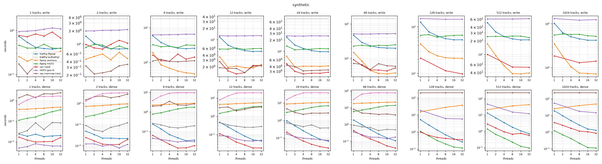
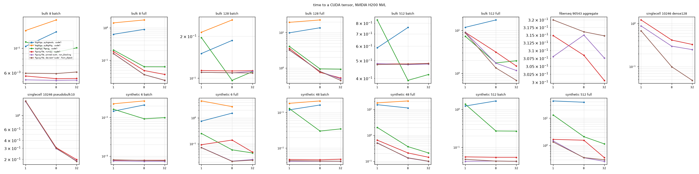

Benchmarks
==========

Every measurement on this page was taken on one machine, 2x AMD EPYC 9575F
(256 cores), with Python 3.13.5, numpy 2.5.3 and numba 0.68. ``benchmarks/compare_readers.py`` and
``benchmarks/compare_writers.py`` in the repository run the reader and writer
comparisons on any bigWigs and BED files.

Reading
-------

The test read 167,750 windows of 1,000 bp, centred on the fold-0 training
peaks and negatives of ENCODE ATAC-seq experiment ENCSR123WME, from two
public bigWigs held on tmpfs: the ATAC-seq signal of HG02943 (ENCFF830RWF,
238 MB) and the DNase-seq signal of dorsolateral prefrontal cortex
(ENCFF989SAK, 645 MB). Of the 167.75 million bases, 11.9 million are nonzero
in the ATAC file and 19.0 million in the DNase file.

Each configuration ran in its own process, three times, and the table gives
the median, file opening included. To give the other libraries more threads,
the windows were split into 8 chunks read on a thread pool, each chunk with
its own file handle. The table gives every library the windows sorted by
position, which helps the others' caching. figwig sorts them itself: given
unsorted, it took 0.144 s and 0.292 s on 8 threads. Every library returned
the same values on every window, once pyBigWig's NaN for bases without an
interval was set to 0.

===========================================  ==============  ===============  ===============  ================
library                                      ATAC, 1 thread  ATAC, 8 threads  DNase, 1 thread  DNase, 8 threads
===========================================  ==============  ===============  ===============  ================
pybigtools 0.2.5, ``values()`` per window    1.25 s          1.42 s           1.98 s           2.21 s
pyBigWig 0.3.26, ``values()`` per window     3.95 s          4.08 s           4.50 s           4.64 s
pybbi 0.4.2, ``stackup``                     9.61 s          9.48 s           10.75 s          10.63 s
figwig 0.1.0                                 0.81 s          **0.135 s**      1.85 s           **0.277 s**
===========================================  ==============  ===============  ===============  ================

On one thread figwig took 0.81 s to pybigtools' 1.25 s on the ATAC file, and
1.85 s to 1.98 s on the denser DNase file. Its advantage is that its threads
run in parallel.

ISA-L decompression
~~~~~~~~~~~~~~~~~~~

The reader above, with ``engine='auto'`` where python-isal 1.8 is installed
(the ``isal`` extra), against ``engine='zlib'`` on the same branch and the
reader before the engines were added, on the same 167,750 windows from
tmpfs. Every setting ran in its own process, five times, alternating; the
table gives the median of the second read in each process, and the last
column the first read, which includes loading the compiled kernels and
ISA-L's one-block self-check. The load on the shared machine was 58 to 62
of 256 cores throughout. Every run gave the same values.

======  =======  ============  =================  ===========  =============  ===============================
bigWig  threads  zlib, before  zlib, this branch  ISA-L        ISA-L speedup  first read, zlib before / ISA-L
======  =======  ============  =================  ===========  =============  ===============================
ATAC    1        1.067 s       1.053 s            **0.774 s**  1.38x          1.123 s / 0.885 s
ATAC    2        0.562 s       0.558 s            **0.410 s**  1.37x          0.650 s / 0.541 s
ATAC    4        0.297 s       0.301 s            **0.223 s**  1.33x          0.385 s / 0.369 s
ATAC    8        0.176 s       0.177 s            **0.136 s**  1.29x          0.276 s / 0.285 s
DNase   1        2.030 s       2.079 s            **1.366 s**  1.49x          2.104 s / 1.510 s
DNase   2        1.066 s       1.075 s            **0.699 s**  1.53x          1.135 s / 0.816 s
DNase   4        0.561 s       0.557 s            **0.401 s**  1.40x          0.636 s / 0.518 s
DNase   8        0.311 s       0.306 s            **0.221 s**  1.41x          0.408 s / 0.379 s
======  =======  ============  =================  ===========  =============  ===============================

ISA-L inflates bigWig blocks 1.3 to 1.5 times faster than zlib, more at
fewer threads, where decompression is a larger share of the read; the zlib
engine itself is unchanged. On a first read the gain is 1.0 to 1.4x.

Writing
-------

The writers wrote the values of two tracks again, held in memory as numpy
arrays: the 5' ends of the reads of ENCODE ATAC-seq BAM ENCFF877LRY on the
plus strand, as counts at 15,875,960 single bases, and the fold-change signal
of ENCODE snATAC-seq pseudobulk ENCSR206UWN, ENCFF932UQM, as 21,212,477
intervals. figwig wrote one ``BigWigWriter.write`` per chromosome, single
bases as windows of width 1, pyBigWig one ``addEntries`` per chromosome, and
pybigtools one ``write()`` from an iterator of tuples. Every write, opening
the file and closing it included, ran in its own process after a warm-up
write of the first 1,000 values of each chromosome, three times, onto tmpfs,
and the table gives the median, at compression level 6. pybigtools 0.2.5's
``write()`` takes no option for zoom levels and writes them, so it was timed
with them only. The libraries were pyBigWig 0.3.26, pybigtools 0.2.5 and
deflate 0.9.0. Every writer's file gave the same values on 2,000 windows of
1,000 bases read back with figwig.

================================  ==========  =====================  ==========  =====================
writer                            counts      counts, zoom levels    signal      signal, zoom levels
================================  ==========  =====================  ==========  =====================
pyBigWig 0.3.26                   4.20 s      12.80 s                7.41 s      10.48 s
pybigtools 0.2.5                              4.45 s                             5.47 s
figwig, zlib, 1 thread            4.25 s      12.09 s                6.21 s      8.10 s
figwig, zlib, 8 threads           0.53 s      1.63 s                 0.78 s      1.09 s
figwig, libdeflate, 1 thread      1.07 s      4.85 s                 1.80 s      3.27 s
figwig, libdeflate, 8 threads     **0.18 s**  **0.75 s**             **0.30 s**  **0.55 s**
================================  ==========  =====================  ==========  =====================

figwig's files were the size of pyBigWig's: 35.7 and 107.1 MB without zoom
levels, against 35.8 and 108.0 MB, and 214.0 and 126.5 MB with them, against
213.9 and 127.4 MB. pybigtools chooses its zoom levels differently, and wrote
96.4 and 162.2 MB. Building zoom levels took from a quarter to three quarters
of figwig's time. Its peak memory was above pyBigWig's without zoom levels,
554 MB against 354 MB for the counts on one thread, of which the arrays of
values held 318 MB, and below it with them, 739 MB on 8 threads against
1,089 MB.

The batch pipeline
~~~~~~~~~~~~~~~~~~

``compare_writers.py`` again, figwig only, before and after the writer
started planning each batch on a thread of its own and encoding and
compressing it on the pool, on the counts and signal tracks above and on
the ATAC-seq and DNase-seq bigWigs of the reading benchmark (26.4 and 77.6
million intervals). Three repeats each, the median, at a load of 57 to 63 of
256 cores; the arrow goes from before to after. Every file written was byte
for byte the one written before.

===================  =========================  =======================  =========================  =========================
track                libdeflate, 1 thread       libdeflate, 8 threads    zlib, 1 thread             zlib, 8 threads
===================  =========================  =======================  =========================  =========================
counts               1.11 s → 1.03 s (1.08x)    0.21 s → 0.14 s (1.54x)  4.35 s → 4.29 s (1.01x)    0.53 s → 0.54 s (0.99x)
counts, zoom levels  4.90 s → 4.82 s (1.02x)    0.76 s → 0.68 s (1.12x)  12.16 s → 12.14 s (1.00x)  1.65 s → 1.64 s (1.00x)
signal               1.79 s → 1.74 s (1.03x)    0.32 s → 0.22 s (1.47x)  6.32 s → 6.20 s (1.02x)    0.81 s → 0.78 s (1.04x)
signal, zoom levels  3.18 s → 3.12 s (1.02x)    0.53 s → 0.45 s (1.19x)  8.20 s → 8.05 s (1.02x)    1.07 s → 1.07 s (1.00x)
ATAC                 3.32 s → 3.19 s (1.04x)    0.64 s → 0.42 s (1.51x)  15.67 s → 15.38 s (1.02x)  1.99 s → 1.94 s (1.03x)
ATAC, zoom levels    12.66 s → 12.70 s (1.00x)  2.08 s → 1.90 s (1.09x)  35.94 s → 36.06 s (1.00x)  4.80 s → 4.75 s (1.01x)
DNase                9.61 s → 9.04 s (1.06x)    1.67 s → 1.19 s (1.40x)  49.14 s → 48.34 s (1.02x)  6.23 s → 6.10 s (1.02x)
DNase, zoom levels   27.83 s → 27.86 s (1.00x)  4.37 s → 3.97 s (1.10x)  90.68 s → 89.72 s (1.01x)  11.97 s → 11.70 s (1.02x)
===================  =========================  =======================  =========================  =========================

With libdeflate and no zoom levels the calling thread, which laid out every
block itself, was the limit on 8 threads, and the pipeline takes 1.4 to 1.5
times less there. Elsewhere the compressor (zlib) or the zoom pass sets the
time, and the gain is 0 to 19%. Peak memory is 3 to 12% lower without zoom
levels, since a threaded writer takes batches of 786,432 items instead of
1,048,576, and within 6% either way with them.

figwig bam2bw
-------------

Two inputs
~~~~~~~~~~

``figwig bam2bw`` and bam2bw 0.5.1 converted the reads of ENCODE ATAC-seq BAM
ENCFF877LRY (2.4 GB) with default flags, to two stranded bigWigs, and the
18.9 million scATAC-seq fragments of ``Alpha_unt.fragments.tsv.gz`` with
``-f -u``, to one bigWig. Each call ran in its own process after a warm-up
call on a tiny input and with the input in the page cache, with
``OPENBLAS_NUM_THREADS`` set to ``-p``, and its peak memory is that of the
process and its children, sampled every 50 ms. The table gives figwig's
median of five runs at ``-p 2`` and one run at ``-p 8``, and one run of
bam2bw, which reads one file in one process whatever ``-p`` is. pysam was
0.24.1, and the files were on a disk rather than tmpfs.

=======================  ==========  ==========  ================  ======================  ===================
\                        BAM         fragments   peak memory, BAM  peak memory, fragments  bigWigs, both calls
=======================  ==========  ==========  ================  ======================  ===================
bam2bw 0.5.1, ``-p 2``   58.48 s     28.45 s     3,039 MB          2,866 MB                135.5 MB
figwig bam2bw, ``-p 2``  **4.65 s**  **1.73 s**  910 MB            1,061 MB                139.8 MB
figwig bam2bw, ``-p 8``  **1.82 s**  **1.31 s**  949 MB            1,180 MB                139.8 MB
=======================  ==========  ==========  ================  ======================  ===================

figwig's bigWigs are 3% larger because they are compressed at level 1
rather than pyBigWig's level 6. The first call in a new environment also
compiles figwig's kernels, which took 1.1 s on the tiny input.

Coverage of every aligned base
~~~~~~~~~~~~~~~~~~~~~~~~~~~~~~

``figwig bam2bw -c -u`` and deepTools 4.0.0's ``bamCoverage --binSize 1``
each wrote the coverage of the same BAM's reads to one bigWig, on tmpfs;
``figwig bam2fw -c -u`` wrote it as a figwig file. The two bigWigs hold the
same value at every one of hg38's 3,099,750,718 bases.

====================================  ========  ========  ========  ========
command                               threads   time      peak RSS  output
====================================  ========  ========  ========  ========
``figwig bam2bw -c -u``               1         11.3 s    1.5 GB    193 MB
``figwig bam2bw -c -u``               8         1.6 s     0.54 GB   193 MB
``figwig bam2bw -c -u``               32        1.05 s    2.4 GB    193 MB
``figwig bam2fw -c -u``               1         22.7 s    1.7 GB    79 MB
``figwig bam2fw -c -u``               8         4.9 s     0.63 GB   79 MB
``figwig bam2fw -c -u``               32        2.3 s     1.7 GB    79 MB
``bamCoverage --binSize 1``           1         46.2 s    1.3 GB    249 MB
``bamCoverage --binSize 1``           8         14.9 s    4.7 GB    249 MB
====================================  ========  ========  ========  ========

figwig's rows are medians of three runs with ``/usr/bin/time``'s peak RSS,
with about a tenth of the server's cores in use by other jobs; deepTools'
are one run each at a load of 38 to 40, with the peak memory of the process
tree sampled every 50 ms. On one thread figwig keeps two events per aligned
block of every read and sorts them, as for ``-f``; from ``-p 8`` it reads
this sorted, indexed BAM a region at a time on every core (:doc:`bam2bw`),
so that its peak is the regions in flight rather than the whole file's
events, and grows with ``-p``. The figwig file is a runs chunk per tile,
which takes less space and, on one thread, longer to write; on threads each
4 Mb of a chromosome goes to the writer as one window, whose tiles it
encodes in parallel, or as its runs where it changes value less often than
once per 1,024 bases, as sparse coverage such as RNA-seq's does; ``figwig
reorder`` writes the file again as the same 79 MB of runs chunks. deepTools'
time is its own reading of the BAM through pysam, a process per thread.

Ten more experiments of the test-data collection, from 40 MB to 2.4 GB,
single- and paired-end, two genomes, spliced short and long reads, were
converted the same way (tmpfs; deepTools one run each at a load of 35 to
45). In every one the two bigWigs hold the same value at every base of every
chromosome of the BAM's header, 3.1 billion for hg38 and 2.7 billion for
mm10, and the same total. Seconds and peak RSS at 1 / 8 threads or
processes:

.. list-table::
   :header-rows: 1

   * - experiment
     - BAM
     - ``figwig bam2bw -c -u``, 1 / 8 threads
     - ``bamCoverage --binSize 1``, 1 / 8 processes
   * - ChIP-seq SE, K562 CTCF, hg38
     - 948 MB
     - 5.9 s, 1.1 GB / 1.0 s, 0.85 GB
     - 25.4 s, 1.1 GB / 11.1 s, 5.2 GB
   * - ChIP-seq PE, SK-N-SH H3K4me3, hg38
     - 2.3 GB
     - 10.2 s, 1.4 GB / 1.4 s, 0.57 GB
     - 36.4 s, 1.2 GB / 14.1 s, 4.7 GB
   * - ATAC-seq PE, HCT116, hg38
     - 2.4 GB
     - 11.4 s, 1.5 GB / 1.6 s, 0.54 GB
     - 46.2 s, 1.3 GB / 14.9 s, 4.5 GB
   * - DNase-seq PE, K562, hg38
     - 46 MB
     - 0.47 s, 0.24 GB / 0.33 s, 0.25 GB
     - 8.5 s, 1.0 GB / 4.4 s, 4.4 GB
   * - PRO-cap PE, K562, hg38
     - 1.4 GB
     - 6.2 s, 0.47 GB / 1.2 s, 0.57 GB
     - 27.3 s, 1.2 GB / 8.0 s, 2.8 GB
   * - RNA-seq PE, K562, hg38
     - 67 MB
     - 0.50 s, 0.16 GB / 0.29 s, 0.22 GB
     - 8.3 s, 1.0 GB / 4.3 s, 3.4 GB
   * - CUT&RUN PE, K562 CTCF, hg38
     - 40 MB
     - 0.45 s, 0.21 GB / 0.39 s, 0.24 GB
     - 8.5 s, 1.0 GB / 4.3 s, 4.5 GB
   * - MNase-seq PE, K562, hg38
     - 118 MB
     - 0.86 s, 0.30 GB / 0.38 s, 0.36 GB
     - 9.9 s, 1.1 GB / 4.7 s, 4.0 GB
   * - ChIP-nexus SE, mESC Nanog, mm10
     - 1.1 GB
     - 6.3 s, 1.3 GB / 1.0 s, 0.85 GB
     - 26.6 s, 0.9 GB / 11.3 s, 3.7 GB
   * - PacBio RNA long reads, K562, hg38
     - 71 MB
     - 0.59 s, 0.14 GB / 0.32 s, 0.21 GB
     - 9.5 s, 1.0 GB / 4.3 s, 3.7 GB

figwig's times were measured again once ``-c`` read large indexed BAMs a
region at a time: medians of three runs with GNU time's peak RSS, with about
a tenth of the server's cores in use by other jobs; deepTools' are the
single runs above. On the five BAMs of 0.9 GB or more figwig was 3.6 to 4.4
times faster than deepTools on one thread and 7 to 11 times on eight, which
read these five a region at a time (:doc:`bam2bw`); deepTools' processes
each hold their own copy of the work and the small files are bound by its
start-up. On one thread figwig's peak grows with the file (the keys of every
read end, 8 bytes each); on eight, with the regions in flight; deepTools'
grows with the processes.

Every file of a test-data collection
~~~~~~~~~~~~~~~~~~~~~~~~~~~~~~~~~~~~

Both also ran on every file of a collection of public test data that bam2bw
takes: 591 BAM, SAM, BED and TSV files from 28 assay directories, from 3
records to a 10 GB ATAC-seq BAM, each under 5 to 9 sets of flags. Each run was
timed once, 16 at a time, interpreter start-up included. In all 3,781 runs
that bam2bw completed, ``figwig bam2bw`` gave the same exit code, messages
and decoded bigWig entries.

.. image:: figures/bam2bw-timings.png
   :alt: Wall time of figwig bam2bw against bam2bw 0.5.1, log scales
   :width: 600px

In the 155 runs where bam2bw took a second or more, ``figwig bam2bw`` was a
median 3.2 times faster, and 7 times faster on the 10 GB BAM at ``-p 1``
(40 s against 282 s), or 27 times at ``-p 4``. In the 3,511 runs that bam2bw
finished in under half a second, it took a median 0.12 s longer, most of it
importing numba and loading its compiled kernels. With ``--mate_pairs``
(hollow points) both read with pysam's loop and take the same time. The
points well above the line are TSV files that are not coordinates, such as
quantification tables and 10x feature lists, whose every line names a
different sequence that is not in the sizes file: the fast reader returns to
Python for each new name, where bam2bw's loop skips the line.

The runs were repeated with their memory measured: the peak is the larger of
the whole process tree's resident set, sampled every 20 ms, and the largest
single process's exact peak (GNU time's maximum resident set size); the mean
is the process tree's resident set averaged over the run.

.. image:: figures/bam2bw-memory.png
   :alt: Peak and mean memory of figwig bam2bw against bam2bw 0.5.1, log scales
   :width: 750px

Where bam2bw's peak was under 250 MB, ``figwig bam2bw``'s start-up held about
55 MB more, numba and its compiled kernels: a median of 98 MB against 43 MB.
On the 10 GB BAM its peak was 4.3 GB against bam2bw's 11.6 GB, and 7.5 GB
against 20.2 GB with ``-u -f``; with ``--mate_pairs``, read by pysam's loop in
both, the two were the same (6.6 and 6.7 GB). These runs were made before
``figwig bam2bw`` dropped the keys it had counted while still reading a BAM,
which lowers its peak on BAM files: on the 10 GB BAM at ``-p 1``, run one at a
time, it is now 2.9 GB, and 4.9 GB with ``-u -f``, in the same time.

figwig files
------------

The figwig file was measured against the other ways of holding many
tracks (``benchmarks/compare_formats.py`` and ``compare_sparse.py`` run
the bigWig and figwig-file parts on any inputs): the same tracks as one
bigWig per track read by figwig, by
pybigtools 0.2.5 and by pyBigWig 0.3.26 (those two on a thread pool of
window chunks, one ``values()`` per window, since neither reads on
threads itself), as a zarr 3 array (zstd, chunks of tracks x 65,536,
zarr's own pool set to the thread count), the same array through zarrs
0.2.3, the Rust codec pipeline for zarr-python, with its chunk
concurrency pinned to one chunk for the reads (each call touches one or
two, and its default splits them across its pool at twice the time;
measured on a later day at a load of 35 to 48 beside a second run of
zarr-python, which read within 0.7 to 1.3 of the times in its row), as
an HDF5 dataset (h5py, gzip 4, the same chunks) and as a raw numpy
memmap, and the figwig file in both orders. Every configuration ran in its own process under ``nice``,
files on tmpfs, OMP, MKL and OpenBLAS pinned to one thread, while other
jobs kept the machine's load at 55 to 70. Reads are the median of up to
five repeats after a warm-up that compiles the kernels and opens the
files; writes the best of two. In every configuration each reader's
output was checked against the others' (one SHA-256 per read), and they
agreed.

Count tracks, 1 to 1,024, over chr1
~~~~~~~~~~~~~~~~~~~~~~~~~~~~~~~~~~~

The tracks are chr1 of the six count tracks the examples use (the two
strands of the 5' ends of ENCODE ATAC-seq BAM ENCFF877LRY, the two
strands of PRO-cap ENCFF994CSC and ENCFF253HUA, and the unstranded cut
counts of ATAC-seq ENCFF830RWF and DNase-seq ENCFF989SAK), uint16, 1.1
percent of bases nonzero; past six, track i is track i mod 6 rolled by a
seeded offset, so it has the statistics of a real track and shares no
position with it. The figwig file is one group of all tracks at a tile of
16,384 and libdeflate level 6; zarr, HDF5 and npy store uint16 as figwig
does. The read is 8,192 random windows of 2,048 bases into float32, or
2,048 and 1,024 windows at 512 and 1,024 tracks, so that the dense output
stays under 8 GB. Seconds at 1 / 8 / 32 threads:

.. list-table::
   :header-rows: 1

   * - format, read
     - 6 tracks
     - 48 tracks
     - 512 tracks
     - 1,024 tracks
   * - figwig file, position order
     - 0.065 / 0.017 / 0.021
     - 0.43 / 0.085 / 0.044
     - 1.16 / 0.22 / 0.11
     - 1.31 / 0.21 / 0.13
   * - figwig file, track order
     - 0.046 / 0.029 / 0.030
     - 0.36 / 0.17 / 0.18
     - 2.77 / 0.66 / 0.56
     - 3.75 / 1.15 / 0.86
   * - bigWigs, figwig
     - 0.24 / 0.048 / 0.036
     - 1.85 / 0.27 / 0.11
     - 13.1 / 1.76 / 0.70
     - 19.1 / 2.62 / 1.28
   * - bigWigs, pybigtools
     - 0.77 / 1.41 / 1.74
     - 5.9 / 11.0 / 13.6
     - 21 / 36 / 42
     - 25 / 39 / 49
   * - bigWigs, pyBigWig
     - 2.23 / 2.56 / 2.75
     - 17.5 / 20.0 / 21.7
     - not run
     - not run
   * - zarr, zstd
     - 1.95 / 2.25 / 2.61
     - 8.1 / 4.0 / 3.7
     - 46 / 15 / 12
     - 55 / 18 / 15
   * - zarrs, zstd
     - 1.52 / 2.44 / 2.57
     - 8.2 / 23 / 25
     - 72 / 76 / 76
     - 77 / 68 / 70
   * - HDF5, gzip 4
     - 3.8 / 9.5 / 9.5
     - 31 / 78 / 75
     - 229 / 230 / 230
     - 232 / 233 / 233
   * - npy memmap, raw
     - 0.26 / 0.15 / 0.20
     - 0.90 / 0.43 / 0.48
     - not run
     - not run

.. list-table::
   :header-rows: 1

   * - format, write, and size
     - 6 tracks
     - 48 tracks
     - 512 tracks
     - 1,024 tracks
   * - figwig file, position order
     - 1.9 / 0.56 / 0.46, 20 MB
     - 15.0 / 3.7 / 3.8, 148 MB
     - 172 / 38 / 39, 1.5 GB
     - 350 / 75 / 72, 3.1 GB
   * - figwig file, track order
     - 3.3 / 2.6 / 3.1, 84 MB
     - 23 / 24 / 25, 676 MB
     - 248 / 255 / 235, 7.2 GB
     - 551 / 575 / 520, 14.4 GB
   * - bigWigs, figwig (with zoom levels)
     - 5.9 / 2.6 / 2.6, 156 MB
     - 47 / 21 / 20, 1.3 GB
     - 504 / 221 / 211, 13.3 GB
     - 1,020 / 454 / 421, 26.6 GB
   * - bigWigs, pyBigWig (1 thread)
     - 18.3, 193 MB
     - 143, 1.5 GB
     - not run
     - not run
   * - zarr, zstd
     - 1.6 / 1.7 / 1.4, 33 MB
     - 9.2 / 4.6 / 5.3, 267 MB
     - 100 / 53 / 52, 2.8 GB
     - 185 / 129 / 140, 5.7 GB
   * - zarrs, zstd
     - 0.49 / 0.42 / 0.45, 33 MB
     - 4.6 / 3.5 / 3.1, 267 MB
     - 63 / 63 / 67, 2.8 GB
     - 170 / 169 / 163, 5.7 GB
   * - HDF5, gzip 4
     - 6.2 / 6.4 / 6.5, 39 MB
     - 52 / 52 / 53, 309 MB
     - 604 / 603 / 617, 3.3 GB
     - 1,320 / 1,210 / 1,250, 6.6 GB
   * - npy memmap, raw
     - 1.1 / 1.0 / 1.1, 3.0 GB
     - 7.2 / 7.0 / 5.9, 23.9 GB
     - not run
     - not run

The figwig file reads 10 times faster than the same tracks as bigWigs on
one thread and 2 to 6 times on 32, and is 8 times smaller than bigWigs
figwig writes; both of figwig's readers gain from threads, where
pyBigWig, pybigtools and HDF5 get slower with more of them (a lock or the
GIL) and zarr stops at about 4 times, its reads being one Python call per
window. zarrs reads those calls at zarr-python's one-thread speed and
gains nothing from the Python threads, with 8 or 32 of them calling into
its pool of as many threads slower than one; reading 256 windows in one
call through ``oindex``, the pattern it is built for, it matches
zarr-python. It writes the arrays 1.1 to 3.5 times faster than
zarr-python. Track order is the faster of the two for a few tracks, where its
raw blocks need no inflating, and position order past about 48. The
figwig writer is the fastest of the compressed formats on 8 threads and
more at every track count (512 tracks in 38 s against zarr's 53 s, 1,024
in 75 s against 129 s), and on one thread up to 128 tracks; past that,
one thread's encoding of the values is the cost (172 s against zarr's
100 s at 512), and the writer gains little from 8
threads to 32, since the file writes and the index stay on the calling
thread. The track-order writer encodes on the calling thread and does
not gain at all. pyBigWig and pybigtools were not run at 512 tracks and
above, nor the memmap, whose file would be 255 GB. The write timings
include producing each piece of input, the same for every format, which
is about a fifth of a one-thread figwig write of 128 tracks.

Real experiments, 1 to 512 ENCODE tracks, over chr1:0-30 Mb
~~~~~~~~~~~~~~~~~~~~~~~~~~~~~~~~~~~~~~~~~~~~~~~~~~~~~~~~~~~

512 hg38 bigWigs sampled from the ChromBPNet collection on this machine,
mostly float signal with 6 to 8 percent of bases nonzero (three sampled
files held infinite values, which no figwig writer accepts, and the next
candidates stood in), over the first 30 Mb of chr1 so that the dense
forms fit the budget; the figwig file is one group at the defaults, zarr
and HDF5 store float32. The same reads as above. Seconds at 1 / 8 / 32
threads:

.. list-table::
   :header-rows: 1

   * - format, read
     - 8 tracks
     - 128 tracks
     - 512 tracks
   * - figwig file, position order
     - 0.18 / 0.034 / 0.022
     - 3.07 / 0.46 / 0.33
     - 8.7 / 1.15 / 0.56
   * - figwig file, track order
     - 0.066 / 0.032 / 0.030
     - 0.94 / 0.48 / 0.39
     - 2.59 / 1.14 / 0.79
   * - bigWigs, figwig
     - 0.21 / 0.048 / 0.048
     - 3.81 / 0.72 / 0.80
     - 7.1 / 1.50 / 1.62
   * - bigWigs, pybigtools
     - 0.68 / 1.01 / 1.43
     - 10.9 / 14.3 / 19.9
     - 24 / 19.5 / 25
   * - bigWigs, pyBigWig
     - 1.57 / 1.97 / 2.21
     - not run
     - not run
   * - zarr, zstd
     - 3.3 / 3.1 / 3.2
     - 90 / 32 / 25
     - 97 / 24 / 19
   * - HDF5, gzip 4
     - 1.8 / 17.8 / 32
     - 533 / 538 / 539
     - 534 / 536 / 539
   * - npy memmap, raw
     - 0.11 / 0.11 / 0.095
     - not run
     - not run

.. list-table::
   :header-rows: 1

   * - format, write, and size
     - 8 tracks
     - 128 tracks
     - 512 tracks
   * - figwig file, position order
     - 1.8 / 1.3 / 1.3, 44 MB
     - 18.3 / 4.7 / 4.0, 1.0 GB
     - 77 / 14.3 / 14.2, 4.2 GB
   * - figwig file, track order
     - 2.0 / 1.8 / 1.8, 113 MB
     - 15.0 / 12.2 / 11.5, 2.5 GB
     - 70 / 50 / 50, 11.1 GB
   * - bigWigs, figwig (with zoom levels)
     - 11.4 / 9.7 / 10.2, 79 MB
     - 182 / 159 / 168, 1.7 GB
     - 791 / 703 / 707, 7.1 GB
   * - bigWigs, pyBigWig (1 thread)
     - 21.1, 115 MB
     - not run
     - not run
   * - zarr, zstd
     - 1.8 / 1.5 / 1.6, 47 MB
     - 9.9 / 4.8 / 4.5, 1.0 GB
     - 40 / 21 / 30, 4.3 GB
   * - HDF5, gzip 4
     - 4.2 / 3.3 / 3.4, 50 MB
     - 59 / 55 / 55, 1.1 GB
     - 244 / 240 / 240, 4.5 GB
   * - npy memmap, raw
     - 1.6 / 0.33 / 0.37, 960 MB
     - not run
     - not run

Dense float signal is the generic formats' best case and figwig's
hardest: the figwig file is the size of zarr's and HDF5's here, and still
reads 15 to 30 times faster than zarr and 500 times faster than HDF5 at
128 tracks and above. Track order reads these dense tracks faster on one
thread, since its blocks are raw, and the two orders meet at 32 threads.
figwig's bigWig writer, with zoom levels, is 5 to 10 times slower than
the figwig writer on dense signal.

Conversions, genome-wide
~~~~~~~~~~~~~~~~~~~~~~~~

``benchmarks/compare_formats.py`` converted the six count tracks above,
genome-wide this time, and the rolled copies past six, written as bigWigs
by figwig: ``figwig bw2fw`` wrote the figwig file of each set in groups of
8 tracks at a tile of 16,384 bases and level 6, and ``figwig fw2bw`` wrote
it back, one run each, on tmpfs, at a load of 72 to 81:

======  ==========  ===========  =============================  =============================
tracks  bigWigs     figwig file  ``bw2fw``, 1 / 8 / 32 threads  ``fw2bw``, 1 / 8 / 32 threads
======  ==========  ===========  =============================  =============================
1       36.9 MB     26.4 MB      4.0 s / 2.0 s / 2.1 s          5.6 s / 4.9 s / 4.8 s        
2       73.9 MB     48.3 MB      6.3 s / 2.8 s / 2.8 s          11.8 s / 5.8 s / 6.0 s       
6       971.4 MB    227.3 MB     18.2 s / 7.2 s / 7.3 s         38.5 s / 20.4 s / 11.0 s     
24      2,195.1 MB  898.0 MB     70.6 s / 19.8 s / 21.9 s       153.4 s / 71.4 s / 38.0 s    
96      7,089.9 MB  3,593.1 MB   277.2 s / 70.5 s / 72.7 s      614.9 s / 287.7 s / 145.8 s  
======  ==========  ===========  =============================  =============================

The six real tracks are 4.3 times smaller as a figwig file than as
ENCODE's bigWigs, most of the gain on the two ENCODE tracks written as
bedGraph, 883 MB of the 971, and 1.8 times smaller than the same tracks
as bigWigs figwig writes (408 MB); the rolled copies past six are bigWigs
figwig wrote as varStep, and the figwig file is half their size.
``bw2fw`` reads each piece of a chromosome on a thread of its own while
the writer encodes and compresses the piece before it on ``-p`` threads,
and gained nothing past 8; on one thread, about a tenth of its time is
the pass that refuses an infinite value before any of a piece is written.
``fw2bw`` is bound by laying each track's windows out as bigWig sections,
on one thread per track.

``figwig bam2fw`` and ``figwig bam2bw`` converted the 2.4 GB ATAC-seq BAM
ENCFF877LRY, on tmpfs, to one figwig file of two tracks and to two bigWigs:

=================  =======  =======  ========  =======
command            1 core   8 cores  32 cores  output 
=================  =======  =======  ========  =======
``figwig bam2bw``  10.80 s  2.11 s   1.94 s    73.9 MB
``figwig bam2fw``  10.60 s  2.32 s   2.58 s    47.4 MB
=================  =======  =======  ========  =======

Both read the BAM the same way, and ``figwig bam2fw`` writes its counts as
entries on the same cores; it took longer only on 32, where its sort of
each chromosome's entries stays on one.

Fragments files to cells
~~~~~~~~~~~~~~~~~~~~~~~~

``figwig bam2fw --barcode-column 4 --cells cells.tsv -f`` converted the
fragments file of the 10x PBMC experiment above (257,638,540 fragments,
2.64 GB of BGZF, 573,156 barcodes of which 10,246 are called cells) to one
uint8 track per called cell, against the other ways of making a per-cell
file from it: the pandas recipe the skill used to give (chunks of
``read_csv``, numpy composite keys, ``FigWigWriter.write_sparse``), pandas
into a scipy CSR matrix of positions by cells per chromosome saved with
``save_npz`` (the representation of the single-cell table above), and
SnapATAC2 2.10.0's ``pp.import_fragments`` with the same cells as its
whitelist, which stores each cell's fragments rather than per-base
counts. Each ran in its own process on tmpfs with the peak resident
memory of the process tree sampled every 50 ms, one run each, at a load
of 31 to 40. Every output holds the same 491,845,610 fragment ends of
the called cells.

=====================================================  =======  ========  ========  ========
conversion of the 10x PBMC fragments file              threads  time      peak RSS  output
=====================================================  =======  ========  ========  ========
``figwig bam2fw --barcode-column 4 --cells``           1        60.1 s    15.8 GB   1.11 GB
``figwig bam2fw --barcode-column 4 --cells``           8        9.1 s     18.2 GB   1.11 GB
``figwig bam2fw --barcode-column 4 --cells``           32       5.5 s     21.9 GB   1.11 GB
``figwig bam2fw --barcode-column 4``, every barcode    8        44.5 s    21.8 GB   1.26 GB
pandas + ``write_sparse``                              8        140.3 s   23.7 GB   1.11 GB
pandas + scipy CSR, ``save_npz``                       1        125.1 s   12.4 GB   29.1 GB
SnapATAC2 ``import_fragments``                         8        217.4 s   8.1 GB    1.02 GB
=====================================================  =======  ========  ========  ========

The command is 15 times faster than the recipe it replaces and takes
less memory, and 24 times faster than SnapATAC2, which holds less memory
but writes fragments, from which counts over windows or peaks are still
to be computed, where the figwig file's pseudobulks and per-cell windows
read as the single-cell table above shows. The scan of the file runs on
the threads (28 s on one, 4.2 s on 8, 1.1 s on 32, on its own), each
chromosome's keys are merged, counted and decoded on them, the writer
encodes, compresses and checksums on them, and what stays on one thread
is the reading of the file's units, the writer's own thread and
start-up, about 3 s in all, so the whole gains 6.6 times on 8 threads
and 11 times on 32. The peak is three to four times the 8 bytes per
fragment end the keys take. Every barcode of the file, 573,156 tracks
in 18 groups of 32,768, costs five times as long, since each unit of
the file then scans a copy of the barcode table and the barcodes it
finds are numbered afterwards, for a file 13% larger. On the
1,001,098-fragment ``large`` file of the called cells, the figwig
command took 1.4 s on 8 threads and 1.7 s on one, the recipe 1.9 and
6 s, SnapATAC2 1.9 and 2 to 7 s, and the scipy matrix 16 s (medians of
two), at 0.25 to 0.5 GB for the figwig command, 0.3 GB for SnapATAC2
and 3.3 GB for scipy.

Compression levels and codecs
~~~~~~~~~~~~~~~~~~~~~~~~~~~~~

The six tracks were written at each libdeflate level, and read as the
8,192 windows above, on one and eight threads:

=====  ========  ===================  ========  =========
level  file      ``bw2fw -p 8``       1 thread  8 threads
=====  ========  ===================  ========  =========
0      412.3 MB  6.9 s                0.062 s   0.047 s  
1      230.1 MB  6.9 s                0.121 s   0.055 s  
3      232.9 MB  6.8 s                0.119 s   0.056 s  
6      227.3 MB  7.0 s                0.123 s   0.048 s  
9      225.2 MB  7.1 s                0.124 s   0.053 s  
12     217.6 MB  9.5 s                0.122 s   0.050 s  
=====  ========  ===================  ========  =========

Zoom levels cost little: ``bw2fw -p 8 -z 4`` of the six tracks took
7.2 s against 7.1 s without them (the median of three runs each), and the
file was 228.1 MB against 227.3 MB, 0.8 MB for the four levels of bins of
4, 16, 64 and 256 tiles.

Every other chunk of the uncompressed file, 205 MB of payload, was then
compressed through each codec's Python binding on one thread, and
decompressed:

==========================  =====  ==========  ============
codec                       ratio  compress    decompress  
==========================  =====  ==========  ============
zlib 6                      0.547  5.6 s       0.88 s      
libdeflate 1                0.554  1.1 s       0.45 s      
libdeflate 6, the default   0.547  2.0 s       0.45 s      
libdeflate 12               0.524  23.7 s      0.44 s      
ISA-L 0                     0.752  0.3 s       0.37 s      
ISA-L 1                     0.558  1.2 s       0.55 s      
ISA-L 3                     0.566  1.3 s       0.54 s      
zstd 3                      0.542  0.8 s       0.36 s      
zstd 19                     0.523  25.0 s      0.35 s      
shuffle by 4, libdeflate 6  0.556  2.3 s       0.47 s      
==========================  =====  ==========  ============

The level makes little difference: 1 to 12 span 230 to 218 MB and read in
the same time, and the uncompressed file is 1.8 times larger and twice as
fast to read on one thread, the same on eight. ISA-L's streams are 2%
larger than libdeflate's and inflate 20% slower, so the reader keeps
libdeflate; zstd's are 1% smaller at level 3 and 4% at 19 and inflate 25%
faster, which, with the inflate about half of a one-thread read and none
of an eight-thread one, would be at most a tenth of a one-thread read for
another dependency. A byte shuffle before deflate grows the chunks, which
are varints and bytes. The bytes are the values: each of the six count
tracks takes 1.1 to 1.7 bytes per nonzero base as sparse chunks of uint8
(the PRO-cap tracks 3.5, on a fifth as many bases), and choosing dense or
sparse by the compressed rather than the raw size would have saved nothing
on 20,000 sampled tiles of each of three of them.

Sums over intervals of any length
~~~~~~~~~~~~~~~~~~~~~~~~~~~~~~~~~

The 172,732 IDR peaks of the set, which differ in length, summed over
the six tracks, on tmpfs, median of three at load about 60:

=========================================================  ========  ========
method                                                     seconds   peak RSS
=========================================================  ========  ========
``FigWigReader.sums``, 8 threads                           0.25 s    345 MB
``read(bins=width)`` once per distinct width, 8 threads    2.70 s    233 MB
pyBigWig ``stats(type="sum", exact=True)``, one process    46 s      201 MB
=========================================================  ========  ========

Over 3,000 single cells as tracks (chr1 to chr5 of the PBMC fragments,
46 million cut sites, one group), the 58,705 peaks on those chromosomes
summed in 0.96 s on 8 threads and 1.5 s on one, the same sums as a sparse
read of the windows gives in 1.2 s.

Dense tracks are stored as runs and dense chunks rather than nonzero
bases. In a runs chunk the changes of value before an interval are only
decoded, and a run of integers inside it is added once rather than base
by base; the tiles an interval covers whole are taken from the file's
tile sums when the track holds integers whose sums those keep exactly. The
coverage of ATAC-seq BAM ENCFF877LRY, as ``figwig bam2fw -c -u`` writes it,
and the fold change of ENCODE's ENCFF932UQM (float32), each one track,
summed over the 100,548 replicated peaks of K562 ATAC-seq (ENCFF827JWX)
and the 78,733 gene bodies of GENCODE v50's basic annotation, on tmpfs,
median of three:

=================================  ==========  ==========
track, intervals                   1 thread    8 threads
=================================  ==========  ==========
ATAC-seq coverage, peaks           0.41 s      0.085 s
ATAC-seq coverage, gene bodies     0.47 s      0.11 s
fold change, peaks                 0.33 s      0.070 s
fold change, gene bodies           1.55 s      0.26 s
=================================  ==========  ==========

Regional stored summaries
~~~~~~~~~~~~~~~~~~~~~~~~~~

``benchmarks/compare_summaries.py`` compares the optional
:doc:`summary index <summary_restarts>` on/off in both storage orders. Defaults
are 8 and 48 tracks of seeded integer counts and float32 signals, five repetitions
and one thread. Cases cover selected-chromosome and whole-genome summaries,
aligned and unaligned interval sums, raw reads, pans and zooms, selecting one
or all tracks.

.. code-block:: bash

    python benchmarks/compare_summaries.py \
        --tracks 8 48 --dtype int32 float32 --tile 16384 --tiles 65536 \
        --threads 1 --repeats 3 --selections all \
        --workloads chrom_base sums_local_aligned whole_base raw_windows \
        --workdir benchmarks/results/summary-index-m5-32k

**Apple M5 example.** At revision
`4eb3ecd <https://github.com/tuner/figwig/commit/4eb3ecdd252fb17b134ed034f78b0aaff07d01a7>`_,
with Python 3.12.13, NumPy 2.5.4, numba 0.68.0, deflate 0.9.0 and zlib 1.2.12,
the command above gave these median milliseconds over three repetitions for
all 48 int32 tracks. The seeded synthetic genome has three chromosomes; the
selected chromosome has 2,048 of 100,352 tiles. Times include fresh reader
construction with a warm OS page cache. Columns show ordinary → indexed:

.. list-table::
    :header-rows: 1

    * - Query
      - Position order, ms
      - Track order, ms
    * - Selected-chromosome ``tile_sums``
      - 29.54 → 2.12
      - 41.80 → 4.96
    * - Four nearby aligned integer ``sums``
      - 29.17 → 0.96
      - 40.65 → 4.57
    * - Whole-genome ``tile_sums``
      - 38.83 → 43.45
      - 52.66 → 59.22
    * - Eight raw 2,048-base windows
      - 9.40 → 9.37
      - 31.16 → 30.23

All 336 samples matched across layouts and index settings, including the
same-file index-ignored control. Whole-genome reads still inflate complete
streams and can be slower with restart boundaries.

Supply real inputs with repeated ``--bigwig`` arguments. Additional tracks are
cyclic shifts within source chromosomes; on/off files receive identical values.
Use ``--dtype int32`` for nonnegative integer counts or ``float32`` for signals:

.. code-block:: bash

    python benchmarks/compare_summaries.py --bigwig ENCFF830RWF.bigWig \
        --dtype float32 --tracks 8 --chroms chr1 chr21 chr22 --tile 1024 \
        --repeats 3 --workdir benchmarks/results/encode-summaries

Each file/mode/repetition uses a fresh process. Imports, kernel warmup and a
linear file read precede timing; the OS page cache is warm. Readers are fresh
except during navigation.
Configurations rotate; hashes must match across layouts, flag settings and a
control that ignores the index. ``--baseline-reader`` accepts an older
``figwig.py``; ``--baseline-revision`` verifies it against git. The baseline
shares current helper kernels, recorded in the manifest.

Raw samples, medians, ranges, source/input hashes, source snapshots, environment
and commands go under ignored ``benchmarks/results/``; choose an empty workdir
for each run. Writer time includes
open/write/close; pipeline time also includes source streaming and hashing.
Logical read/decode counters are collected separately, untimed, and do not
measure physical I/O. Peak RSS is the worker's cumulative high water, including
warmups; select one ``--workloads`` value and one ``--selections`` value for an
isolated memory comparison.
These timings cover local-file access.

Dense float tracks and the layout
~~~~~~~~~~~~~~~~~~~~~~~~~~~~~~~~~

The defaults, a tile of 16,384 and groups of 8, suit count tracks, whose
chunks are mostly zero. Dense float tracks are the other case: three
conservation tracks over chr22, phyloP100way, Zoonomia phyloP and
phastCons100way (609 MB as bigWigs; 71%, 71% and 45% of bases nonzero),
were written from float32 arrays in calls of 4 Mb and read as 8,192 random
windows of 2,048 bp over every track, and whole, at the defaults and at
``-t 1024 --groups 1``, against their bigWigs through ``read_bigwig``, on
1, 8 and 32 threads at a load of 26 of 256 cores; the median of 3 after a
warm-up. "Before" is the reader and writer before the runs decoder filled
a window's row in place and batches were sized per thread.

.. list-table::
   :header-rows: 1
   :widths: 40 12 12 12 12 12

   * - 8,192 windows of 2,048 bp
     - file
     - 1 thread
     - 8 threads
     - 32 threads
     - vs bigWigs
   * - three bigWigs, ``read_bigwig``
     - 609 MB
     - 0.80 s
     - 0.12 s
     - 0.11 s
     - 1.0x
   * - tile 16,384, groups of 8, before
     - 181 MB
     - 1.95 s
     - 0.42 s
     - 0.21 s
     - 0.4-0.5x
   * - tile 16,384, groups of 8
     - 181 MB
     - **0.51 s**
     - **0.070 s**
     - **0.034 s**
     - 1.6-3.2x
   * - tile 1,024, groups of 1, before
     - 233 MB
     - 0.78 s
     - 0.13 s
     - 0.056 s
     - 1.0-2.0x
   * - tile 1,024, groups of 1
     - 233 MB
     - 0.37 s
     - 0.070 s
     - 0.047 s
     - 1.7-2.3x

The whole chromosome, 152 million values into float32, read in 0.58, 0.089
and 0.040 s at the defaults (1.78, 0.38 and 0.18 s before), and 0.94,
0.17 and 0.098 s at the small tile. The three tracks were written in 4.1,
0.55 and 0.19 s on 1, 8 and 32 threads at the defaults (4.1, 0.67 and 0.39
s before) and 3.7, 0.54 and 0.24 s at the small tile; on one thread
libdeflate's level 6 is 85% of the write, and a dense float chunk
compresses by 2.4.

Two things made the difference. The writer stores a tile whose values
hold for a base or two, as conservation scores do, as a runs chunk, a
change at every base or two; its decoder took the window's row and called
the per-run kernel at each change, 70 ns a change, where it now fills the
row in place at 3 ns. And a chromosome of 196 KB chunks was one batch of
32 MB after another, 13 for chr22, so 32 threads split each batch's
windows and inflated its chunks again; batches now hold at least two per
thread, and a write call's dense tiles are cut into up to one task per
thread of at least 4 MB where they were two tasks whatever the pool's
size. A 2 kb window from a 16,384-base tile still decodes 16 kb of float32
per track, and every track of its group with it, which is what the small
tile and single groups save on one thread; count tracks go the other way,
since a sparse chunk's other tracks are stepped over by their byte counts,
and 8 of 48 count tracks read in short windows from one group of 48 in a
quarter to a half of the time from 48 groups of one. The same tracks read
in 100 bp bins over the whole of chr22 took 0.09 s from the small-tile
file against 9.8 s for pyBigWig's ``stats``.

Single cells
~~~~~~~~~~~~

The 10,246 called cells of the 10x PBMC ATAC-seq experiment
(``10k_pbmc_ATACv2_nextgem_Chromium_Controller``), 488 million Tn5 cut
sites genome-wide, written with ``write_sparse`` as one uint8 track per
cell in one group (the layout for cells), in track order, as one bigWig
per cell with figwig's writer, and as a scipy CSR matrix of positions x
cells per chromosome saved with ``save_npz`` and held in memory for the
reads. 8,192 windows of 2,048 bases centred on K562 ATAC-seq peaks.
Seconds at 1 / 8 / 32 threads (scipy at 1 / 8):

.. list-table::
   :header-rows: 1

   * - workload
     - figwig, position order (1.0 GB)
     - figwig, track order (2.4 GB)
     - scipy CSR (16.3 GB, in memory)
     - one bigWig per cell (1.4 GB)
   * - write
     - 68 / 37 / 36
     - 71 / 72 / 91
     - 10.6 / 11.4
     - 116 / 78 / 82
   * - 10 pseudobulks over the windows (``labels=``)
     - 1.69 / 0.30 / 0.17
     - 21.7 / 10.0 / refused
     - 5.1 / 4.9
     - 136 / 95 / 96
   * - 128 cells dense over the windows
     - 0.96 / 0.16 / 0.082
     - 0.58 / 0.24 / 0.18
     - 6.6 / 4.9
     - 0.79 / 0.28 / 0.26
   * - every cell's cut sites in 1,024 windows (``sparse=True``)
     - 0.39 / 0.16 / 0.14
     - 7.1 / 5.4 / 5.0
     - 4.3 / 4.7
     - not run

Pseudobulks in the read are 30 times faster than from the sparse matrix
and 500 times faster than from one bigWig per cell, and the file is a
sixteenth of the matrix's size; a tile of cut sites whose nonzero values
are all 1 stores no values. Track order sums 10,246 tracks one block task
at a time, and at 16 and 32 threads its per-thread output copies pass the
8 GiB guard, so it is refused there. The scipy writer only sorts and
saves, and its 16 GB are loaded before any read.

Reads as tracks
~~~~~~~~~~~~~~~

The m6A calls (probability at least 0.5) of the 90,543 reads of a K562
Fiber-seq BAM, 49.6 million calls, one uint8 track per read with the
read's name, span and strand as attributes, in position order in groups of
1,024 consecutive reads (62 MB), in track order (226 MB), and as a scipy
CSR matrix per chromosome (12.7 GB). Windows of 2,048 bases on reads.
Seconds at 1 / 8 / 32 threads (scipy at 1 / 8):

.. list-table::
   :header-rows: 1

   * - workload
     - figwig, position order
     - figwig, track order
     - scipy CSR
   * - write
     - 4.0 / 2.6 / 2.7
     - 6.5 / 9.1 / 10.6
     - 6.8
   * - sum over all reads, 8,192 windows (``labels=``)
     - 0.42 / 0.43 / 0.42
     - 15.7 / 15.8 / 16.0
     - 3.8 / 4.0
   * - calls of every read in 1,024 windows (``sparse=True``)
     - 0.17 / 0.16 / 0.17
     - 7.1 / 7.2 / 7.2
     - 27 / 3.5
   * - each read over its own span (``sums(paired=True)``)
     - 2.7 / 2.7 / 2.7
     - 9.6 / 9.7 / 9.6
     - 5.8 / 6.8

One group of every read is refused, since a chunk holds at most 2**29
values, and a group per read made the sum over 8,192 windows take 230 s,
each read paying a planning step per group; groups of consecutive reads
are the layout. These reads do not gain from threads, since each touches
few chunks and the work is the planning.

To a GPU
~~~~~~~~

Six paths from a file to a CUDA tensor were timed on an H200 NVL
(PCIe), with ``torch.cuda.synchronize()`` before the clock
stopped: the bigWigs read by pybigtools, by pyBigWig and by figwig, each
followed by ``torch.from_numpy`` and ``.cuda()``; the figwig file read
into a numpy array then ``.cuda()``; into a pinned torch buffer through
``out=`` then ``.to("cuda", non_blocking=True)``; and with
``device="cuda"`` then ``torch.from_dlpack``. A DataLoader batch of 64
windows and the full reads above; the single-cell and Fiber-seq files on
the figwig paths. Seconds at 1 / 8 / 32 threads (pybigtools and pyBigWig
at 1 / 8, where they only get slower):

.. list-table::
   :header-rows: 1

   * - path
     - 6 tracks, batch of 64
     - 48 tracks, batch of 64
     - 48 tracks, 8,192 windows
     - 512 tracks, 2,048 windows
     - 128 of 10,246 cells, 8,192 windows
     - 10 pseudobulks of 10,246 cells
   * - bigWigs, pybigtools, ``.cuda()``
     - 0.015 / 0.021
     - 0.12 / 0.16
     - 15.1 / 11.3
     - 43 / 39
     - not run
     - not run
   * - bigWigs, pyBigWig, ``.cuda()``
     - 0.023 / 0.027
     - 0.18 / 0.21
     - 17.7 / 21.1
     - not run
     - not run
     - not run
   * - bigWigs, figwig, ``.cuda()``
     - 0.016 / 0.0093 / 0.0099
     - 0.13 / 0.030 / 0.035
     - 2.0 / 0.37 / 0.21
     - 13.1 / 2.1 / 1.14
     - not run
     - not run
   * - figwig file, numpy, ``.cuda()``
     - 0.00079 / 0.00079 / 0.00078
     - 0.0048 / 0.0047 / 0.0049
     - 0.65 / 0.21 / 0.14
     - 1.67 / 1.56 / 0.36
     - 1.21 / 0.41 / 0.33
     - 1.70 / 0.31 / 0.20
   * - figwig file, pinned ``out=``, ``non_blocking``
     - 0.00075 / 0.00074 / 0.00074
     - 0.0043 / 0.0043 / 0.0043
     - 0.51 / 0.13 / 0.10
     - 1.47 / 0.35 / 0.26
     - 0.88 / 0.30 / 0.25
     - 1.67 / 0.30 / 0.19
   * - figwig file, ``device="cuda"``, ``from_dlpack``
     - 0.00081 / 0.00078 / 0.00077
     - 0.0045 / 0.0043 / 0.0043
     - 0.50 / 0.14 / 0.10
     - 1.34 / 0.36 / 0.30
     - 0.68 / 0.099 / 0.048
     - 1.69 / 0.30 / 0.19

For a DataLoader batch the figwig file reaches the GPU in a millisecond
for 6 tracks and 4 ms for 48, 15 to 40 times ahead of the bigWig readers,
and the three figwig paths are the same there since a batch's transfer is
small. For full reads the transfer is the large part: 3.2 GB of 48 tracks
reaches the GPU in 0.10 s through the pinned buffer against 0.14 s
through a pageable numpy array. ``device="cuda"`` matches the pinned path
where it copies, and wins by 5 times where it scatters: 128 of 10,246
cells over 8,192 windows arrive in 0.048 s against 0.25 s, since the bus
carries 0.002 percent of the bases as entries instead of 8.6 GB of zeros.

Thread scaling
--------------

The reader, the writer and ``figwig bam2bw`` ran again at 1 to 32 threads,
one run at a time, on the inputs above, while other jobs kept the machine's
load at about 20: the reader through
``compare_readers.py`` on the ATAC and DNase files, three times; the writer
through ``compare_writers.py`` on the counts and signal tracks, three times;
and ``figwig bam2bw`` on the BAM and the fragments, three times, with
GNU time's maximum resident set size as its peak memory. Each figure is a
median. Every run of each input gave the same values, and ``figwig bam2bw``
the same bytes, whatever the number of threads.

.. image:: figures/thread-scaling.png
   :alt: Wall time against threads for reading, writing and figwig bam2bw, log scales
   :width: 100%

Reading 167,750 windows of 1,000 bp, sorted by position, file opening
included:

==============  ========  =========  =========  =========  ==========  ==========
bigWig          1 thread  2 threads  4 threads  8 threads  16 threads  32 threads
==============  ========  =========  =========  =========  ==========  ==========
ATAC, 238 MB    0.816 s   0.427 s    0.228 s    0.133 s    0.088 s     0.074 s
DNase, 645 MB   1.852 s   0.952 s    0.499 s    0.272 s    0.180 s     0.164 s
==============  ========  =========  =========  =========  ==========  ==========

Given unsorted, the same reads took 2% to 11% longer. :doc:`threads` has the
times by the number of windows per read.

Writing, at level 6, file opening and closing included:

===============================  ========  ========  ========  ========  ========  ========
track, engine, zoom levels       1         2         4         8         16        32
===============================  ========  ========  ========  ========  ========  ========
counts, libdeflate, none         1.07 s    0.47 s    0.25 s    0.18 s    0.19 s    0.23 s
counts, zlib, none               4.22 s    2.04 s    1.04 s    0.53 s    0.28 s    0.20 s
counts, libdeflate, 10           4.85 s    2.50 s    1.37 s    0.75 s    0.53 s    0.55 s
counts, zlib, 10                 12.11 s   6.08 s    3.16 s    1.63 s    0.87 s    0.55 s
signal, libdeflate, none         1.78 s    0.77 s    0.41 s    0.30 s    0.32 s    0.34 s
signal, zlib, none               6.18 s    2.97 s    1.52 s    0.77 s    0.42 s    0.32 s
signal, libdeflate, 10           3.25 s    1.64 s    0.85 s    0.56 s    0.50 s    0.55 s
signal, zlib, 10                 8.11 s    4.16 s    2.06 s    1.09 s    0.61 s    0.52 s
===============================  ========  ========  ========  ========  ========  ========

``figwig bam2bw``, with peak memory:

====================  ================  ================  ================  ================  ================  ================
input                 ``-p 1``          ``-p 2``          ``-p 4``          ``-p 8``          ``-p 16``         ``-p 32``
====================  ================  ================  ================  ================  ================  ================
BAM, default flags    9.35 s, 831 MB    4.65 s, 874 MB    2.71 s, 888 MB    1.74 s, 925 MB    1.75 s, 968 MB    1.82 s, 1,032 MB
fragments, ``-f -u``  2.91 s, 1,039 MB  1.74 s, 1,326 MB  1.41 s, 1,386 MB  1.25 s, 1,496 MB  1.30 s, 1,414 MB  1.41 s, 1,495 MB
====================  ================  ================  ================  ================  ================  ================
